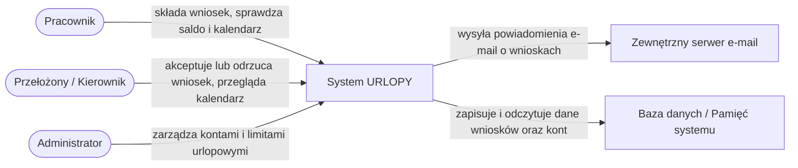

# Diagram kontekstu

System URLOPY pokazany jako jedna całość, z rolami użytkowników i elementami zewnętrznymi, z którymi wymienia informacje.

## Opis

| Element | Rola w diagramie |
|---|---|
| Pracownik | Składa wnioski urlopowe, sprawdza dostępne saldo oraz przegląda kalendarz nieobecności. |
| Przełożony / Kierownik | Przegląda wnioski podwładnych, podejmuje decyzje (akceptacja/odmowa) oraz sprawdza kalendarz zespołu. |
| Administrator | Tworzy konta użytkowników, przydziela role (Pracownik, Kierownik, Admin) oraz zarządza limitami urlopowymi. |
| Zewnętrzny serwer e-mail | Wysyła automatyczne wiadomości e-mail o zmianie statusu wniosków. |
| Baza danych / Pamięć systemu | Miejsce bezpiecznego przechowywania danych użytkowników, historii wniosków i limitów. |

## Zgodność z zakresem

Diagram jest w pełni zgodny z przyjętymi granicami projektu:
- Uwzględnia (IN): Rejestrację i role (Pracownik, Kierownik, Admin), składanie wniosków, sprawdzanie limitów, akceptację/odrzucenie, historię, kalendarz oraz zarządzanie kontami i limitami.
- Nie zawiera (OUT): Integracji z ZUS/PIP, naliczania list płac, grafikach zmianowych oraz obsługi L4/delegacji.